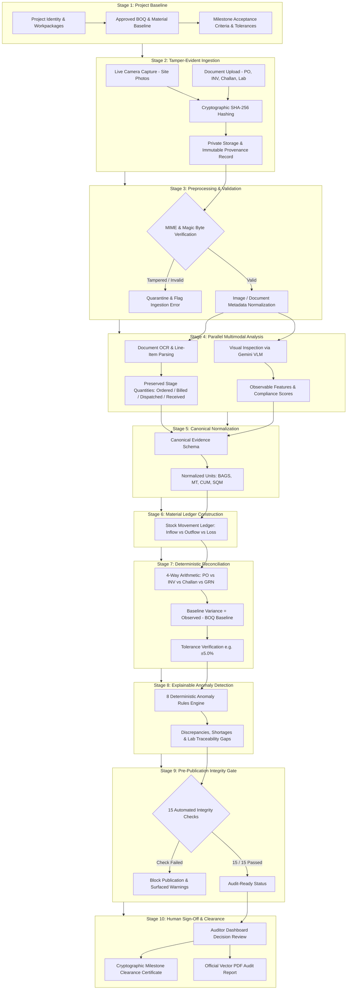

# AuditForge

<div align="center">

[](https://github.com/vinaybhadane/AuditForge2)
[](https://fastapi.tiangolo.com/)
[](https://nextjs.org/)
[](https://ai.google.dev/)
[](https://supabase.com/)
[](./LICENSE)

### **Every Claim. Verified by Evidence.**
**Multi-Stage Construction Milestone Verifier with VLM Audit & Anomaly Detection**

*Engineered for **Hack-A-Night 2026** — 24-Hour National Hackathon at **PVG's College of Engineering and Technology & G.K. Pate (Wani) Institute of Management, Nashik**.*

[Live Repository](https://github.com/vinaybhadane/AuditForge2) • [System Architecture](#-multi-stage-pipeline-architecture) • [Integrity Gate](#-15-point-pre-publication-integrity-gate) • [Quick Start](#-quick-start-guide)

</div>

---

## 👥 Team: CodeCrafters

| Role | Name | GitHub Profile |
| :--- | :--- | :--- |
| **Team Leader** | **Sakshi Patil** | [@sakshipatil-779](https://github.com/sakshipatil-779) |
| **Full Stack & ML Engineer** | **Vinay Bhadane** | [@vinaybhadane](https://github.com/vinaybhadane) |
| **Backend & Domain Specialist** | **Mrunmai Prayage** | [@mrunmaiprayage-jpg](https://github.com/mrunmaiprayage-jpg) |

---

## 🎯 Challenge & Problem Statement

* **Track / Problem Statement**: **Challenge #8 — Multi-Stage Construction Milestone Verifier with VLM Audit & Anomaly Detection**
* **Domain**: PropTech / Applied Computer Vision / Operations Fraud Detection

### The Core Problem
In commercial infrastructure and real-estate construction, **general contractors and infrastructure authorities suffer from massive financial leakages, schedule drift, and unaccounted material diversion**. Traditional management relies on fragmented paper forms, delayed audits, and unvalidated photo uploads:

1. **Fabricated Progress Claims**: Subcontractors routinely submit pre-existing gallery photos, duplicated camera shots from adjacent wings, or historical images to claim milestone sign-offs and unlock retention escrow funds prematurely.
2. **Unverified Subcontractor Billing**: Invoices claim quantities that far exceed approved engineering Bill of Quantities (BOQ) or exceed physical site capacity.
3. **Ghost Deliveries & Off-Book Material Diversion**: Bill-of-Quantities materials (rebar, cement bags, structural steel, ready-mix concrete) marked as "received" or "consumed" that never physically touched site gates, were rejected at quality inspection, or were surreptitiously redirected to other jobs.
4. **Disjointed Document Trails**: Purchase Orders (PO), Vendor Tax Invoices (INV), Delivery Challans (DC), Goods Receipt Notes (GRN), and Concrete Compressive Strength Lab Reports sit in isolated physical silos, making real-time 4-way cross-reconciliation humanly impossible before invoice clearance.

---

## 💡 Proposed Solution: AuditForge

**AuditForge** is an evidence-first, decision-support operations auditing platform that bridges physical reality on construction sites with procurement ledgers, engineering baselines, and commercial billing.

```
  ┌──────────────────────────────┐          ┌──────────────────────────────┐
  │   Live Physical Evidence     │          │    Commercial Documents      │
  │ • Mandatory Live Camera Only │          │ • Tax Invoices & Challans    │
  │ • GPS, Timestamp, Geofenced  │          │ • Purchase Orders & GRNs     │
  │ • Cryptographic SHA-256 Hash │          │ • Concrete Strength Test PDF │
  └──────────────┬───────────────┘          └──────────────┬───────────────┘
                 │                                         │
                 ▼                                         ▼
      Multimodal VLM Assessment               Multi-Pass OCR & Field Extraction
     (Google Gemini 2.5/3.8 Flash)              (PyPDF + Gemini Vision OCR)
                 │                                         │
                 └────────────────────┬────────────────────┘
                                      ▼
                      Canonical Evidence Normalization
                    (Standardized Units: BAGS, MT, CUM)
                                      ▼
                     Deterministic 4-Way Material Ledger
                (PO vs Invoice vs Delivery Challan vs GRN)
                                      ▼
                    Rule-Based Anomaly Detection (8 Rules)
                                      ▼
                    15-Point Pre-Publication Integrity Gate
                                      ▼
                     Authorized Human Auditor Decision
                  (Official Vector PDF & Cryptographic Cert)
```

### Core Product Integrity Tenets
* **Strict Physical Presence Enforcement**: Construction progress evidence strictly mandates live camera capture; disk/gallery uploads are disabled to enforce physical presence and tamper freshness. Commercial documents support both digital PDF upload and live camera scanning.
* **Preserved Quantity Semantics**: Invoiced, dispatched, received, accepted, and consumed quantities remain distinct administrative stages and are never conflated.
* **Deterministic Reconciliation**: Reconciliation math is strictly deterministic with versioned tolerance bands ($\pm5.0\%$). AI provides visual observations and field extraction, but does **not** perform or alter ledger arithmetic.
* **Human-in-the-Loop Decision Support**: AI outputs represent candidate signals. Milestones and disbursement clearance certificates strictly require documented integrity checks and an authorized human signature.
* **Cryptographic Provenance**: Every document, capture frame, and line-item is fingerprinted with SHA-256 hashes and linked directly to immutable audit logs.

---

## 🏗️ Multi-Stage Pipeline Architecture

The AuditForge engine processes evidence across **10 deterministic stages** to transform raw site data into tamper-evident audit conclusions:



---

## 🔍 15-Point Pre-Publication Integrity Gate

Before any audit report can be signed or published, the system executes 15 deterministic publication gate checks against the authoritative database snapshot:

| # | Integrity Gate Check | Description & Validation Rule |
| :---: | :--- | :--- |
| **1** | **Source References Resolvable** | All linked evidence assets must resolve to private storage with verified SHA-256 hashes. |
| **2** | **Identifiable Quantities & Units** | Every quantity must possess an explicit, non-null engineering unit (`BAGS`, `MT`, `CUM`). |
| **3** | **Material & Unit Compatibility** | Unit compatibility verified across all joins; cross-material joins strictly forbidden. |
| **4** | **No Duplicate Joins / Inflation** | Challan dispatches and invoice quantities isolated to avoid artificial double-counting. |
| **5** | **Deterministic Calculations** | Variance formula verified: `Variance = Observed - Baseline; Adjusted = max(0, Variance - Tolerance)`. |
| **6** | **Tolerance Consistency** | Approved BOQ tolerance (e.g., 5.0%) uniformly applied across all reconciliation lines. |
| **7** | **Preserve Missing Quantities** | Absent delivery records are maintained as `MISSING_RECORD`, never silently converted to zero. |
| **8** | **Missing Evidence Never Matched** | Claims lacking source documents strictly hold status `UNRESOLVED` or `MISSING`. |
| **9** | **Finding Counts Agreement** | Summary metrics must exactly match the distinct count of verified anomaly findings. |
| **10** | **Metric Source Traceability** | Document counts, detected materials, and line items must trace to underlying records. |
| **11** | **No Stale Calculations** | Computations must belong to active reconciliation run ID; historical cached values rejected. |
| **12** | **No Hidden Conflicts** | Concrete cube sample-to-batch gaps or vendor mismatches must be surfaced explicitly. |
| **13** | **Linked Evidence for Findings** | Every finding (High/Medium/Low severity) must link to $\ge 1$ resolvable evidence asset. |
| **14** | **PDF Snapshot Value Fidelity** | Vector PDF tables render directly from the database snapshot without re-computation drift. |
| **15** | **Review State Agreement** | Status strictly reflects audit gate state (`AUDIT-READY -- PENDING HUMAN SIGN-OFF`). |

---

## 🛠️ Technology Stack

```
   ┌─────────────────────────────────────────────────────────────┐
   │                        FRONTEND                             │
   │  Next.js 14 (App Router) • React 18 • TypeScript (Strict)   │
   │  Tailwind CSS • Lucide Icons • dynamic Three.js / Drei (/)  │
   └──────────────────────────────┬──────────────────────────────┘
                                  │ JSON / REST / Multipart
                                  ▼
   ┌─────────────────────────────────────────────────────────────┐
   │                        BACKEND                              │
   │  FastAPI (Python 3.11) • Pydantic v2 • SQLAlchemy 2.0 async │
   │  Alembic Migrations • ReportLab Vector PDF Engine           │
   └──────────────┬──────────────────────────────┬───────────────┘
                  │                              │
                  ▼                              ▼
   ┌──────────────────────────────┐┌──────────────────────────────┐
   │         DATABASE & AUTH      ││         AI ENGINE            │
   │  Supabase PostgreSQL with RLS││  Google Gemini 2.5 / 3.8     │
   │  Private-by-default Storage  ││  Flash VLM (google-genai)    │
   │  Server-side JWT validation  ││  PyPDF + Vision Hybrid OCR   │
   └──────────────────────────────┘└──────────────────────────────┘
```

---

## 📁 Repository Structure

```text
AuditForge/
├── .env.example                     # Environment template (API keys, DB, Supabase)
├── .gitignore                       # Clean repository ignore rules
├── AGENTS.md                        # Mission, rules, security, and design guidelines
├── LICENSE                          # MIT License
├── README.md                        # Master project documentation
├── package.json                     # Monorepo workspaces configuration
│
├── apps/
│   ├── web/                         # Next.js 14 Frontend Application
│   │   ├── src/
│   │   │   ├── app/
│   │   │   │   ├── page.tsx         # Interactive 3D Landing Page
│   │   │   │   ├── login/           # Authentication portal
│   │   │   │   └── dashboard/       # Auditor Operations & Evidence Console
│   │   │   ├── components/
│   │   │   │   ├── landing/         # Hero, Features, Comparison, Workflow, Scene
│   │   │   │   └── ui/              # Buttons, Cards, Badges, Modals
│   │   │   ├── lib/                 # Utility functions & environment loaders
│   │   │   └── styles/globals.css   # Tailored cyber-serif theme styling
│   │   ├── public/construction.mp4  # Landing background media asset
│   │   ├── package.json
│   │   └── tsconfig.json
│   │
│   └── api/                         # FastAPI Backend Engine
│       ├── app/
│       │   ├── api/v1/endpoints/    # REST endpoints (auth, projects, evidence, recon, reports)
│       │   ├── audit_engine/        # 10-Stage Audit Core Pipeline
│       │   │   ├── anomaly_detection/# 8-Rule Deterministic Anomaly Engine
│       │   │   ├── extraction/      # OCR, PDF text, structured invoice/challan parser
│       │   │   ├── reconciliation/  # 4-Way Material Ledger & BOQ arithmetic
│       │   │   ├── vision/          # Gemini VLM Construction Site Assessment
│       │   │   └── pipeline/        # Orchestrator & stages
│       │   ├── core/                # Configuration, logging, errors, security
│       │   ├── db/models/           # SQLAlchemy ORM models
│       │   ├── schemas/             # Pydantic v2 schemas
│       │   ├── services/            # Business & domain services
│       │   └── main.py              # Application entrypoint
│       ├── migrations/              # Alembic database migrations
│       ├── tests/                   # 46 Automated Pytest unit & integration tests
│       ├── requirements.txt         # Production backend dependencies
│       └── requirements-dev.txt     # Test & development dependencies
│
└── docs/                            # 14 Full System Specifications
    ├── 01_PROJECT_SPECIFICATION.md
    ├── 02_SYSTEM_ARCHITECTURE.md
    ├── 03_TECH_STACK.md
    ├── 04_DESIGN_SYSTEM.md
    ├── 05_UI_UX_SPECIFICATION.md
    ├── 06_DATABASE_SCHEMA.md
    ├── 07_SECURITY_AND_ACCESS_CONTROL.md
    ├── 08_AI_EVIDENCE_PIPELINE.md
    ├── 09_MATERIAL_RECONCILIATION.md
    ├── 10_ANOMALY_DETECTION.md
    ├── 11_API_CONTRACTS.md
    ├── 12_TESTING_AND_VALIDATION.md
    ├── 13_IMPLEMENTATION_PLAN.md
    └── 14_HACKATHON_DEMO.md
```

---

## 🚀 Quick Start Guide

### Prerequisites
* **Node.js** >= 18.x
* **Python** >= 3.11
* **Supabase PostgreSQL** instance
* **Google Gemini API Key**

### 1. Clone the Repository
```bash
git clone https://github.com/vinaybhadane/AuditForge2.git
cd AuditForge2
```

### 2. Configure Environment Variables
Copy `.env.example` to `.env` in the root and in `apps/api/.env`:
```bash
cp .env.example .env
cp .env.example apps/api/.env
```
Populate your environment credentials:
```ini
# Supabase Database
DATABASE_URL=postgresql+psycopg://postgres:<password>@<host>:5432/postgres?sslmode=require
SUPABASE_URL=https://<your-project-ref>.supabase.co
SUPABASE_ANON_KEY=<your-anon-key>
SUPABASE_SERVICE_ROLE_KEY=<your-service-role-key>

# Google Gemini API (Multimodal VLM)
GOOGLE_GEMINI_API_KEY=<your-gemini-api-key>
GEMINI_MODEL_ID=gemini-2.5-flash
```

### 3. Install Dependencies
```bash
# Install Web and root dependencies
npm install

# Install API Python dependencies
cd apps/api
pip install -r requirements.txt -r requirements-dev.txt
cd ../..
```

### 4. Run Migrations & Start Servers
```bash
# Terminal 1: Run Backend API (FastAPI on Port 8000)
npm run dev:api
# Swagger Documentation: http://127.0.0.1:8000/api/v1/docs

# Terminal 2: Run Web Application (Next.js on Port 3000)
npm run dev:web
# Web Console: http://localhost:3000
```

---

## 🧪 Testing & Verification

The repository includes a comprehensive automated test suite ensuring end-to-end reliability:

```bash
# Run complete Python test suite (46 passed tests)
npm run test:api
# Output: ======================= 46 passed in 22.54s =======================

# Run TypeScript type check
npm run typecheck:web
# Output: tsc --noEmit (0 errors)
```

---

## 🏆 Hackathon Details

* **Hackathon**: **Hack-A-Night 2026** (24-Hours National Hackathon)
* **Venue**: **PVG's College of Engineering and Technology & G.K. Pate (Wani) Institute of Management, Nashik**
* **Challenge Track**: **Challenge #8 — Multi-Stage Construction Milestone Verifier with VLM Audit & Anomaly Detection**
* **Team**: **CodeCrafters** — Sakshi Patil (Team Leader), Vinay Bhadane, Mrunmai Prayage

---

## 📄 License

This project is licensed under the **MIT License** — see the [LICENSE](./LICENSE) file for details.

Copyright &copy; 2026 **Sakshi Patil, Vinay Bhadane, Mrunmai Prayage**. All rights reserved.
